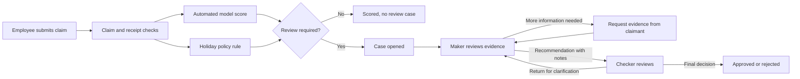

# Visual claim review workflow plan

## What the reference video demonstrates

The supplied Zip walkthrough is a procurement request flow. A request is collected, documents are attached, conditional questions appear, and a visual map shows approval steps. Cards show each step's assignee, status, due date, and actions. Some steps wait for earlier ones; others run in parallel. A side panel shows request details, comments, and an audit trail.

AuditAI should adopt the interaction pattern, not the procurement-specific steps. Expense claims already have authentication, OCR, scoring, maker recommendations, checker sign-off, and a case audit trail. The new map should expose those existing decisions clearly before expanding the workflow.

## Plain-language distinction

The model is an automated **signal**, not an approver. During model training, AuditAI compares candidate detectors on chronological validation data and saves the selected detector. During a claim review, only that saved model scores the claim. Its score and evidence enter the workflow as one automated step. Human makers and checkers decide the outcome; the model does not approve or reject a claim.

## Proposed claim journey

The first release can show the current path through maker and checker. The evidence-request and return loops require new behavior and should follow only after the basic map accurately reflects current data.

## Stage 1 — trustworthy case state

1. Define one documented transition table for `open`, `maker_recommended_approve`, `maker_recommended_reject`, `closed_approved`, `closed_rejected`, and `cancelled_unflagged`. Keep claim status and case status distinct.
2. Expose a single case-workflow API response with ordered nodes, dependencies, actor or assignee, status, timestamps, permitted actions, and evidence references. Construct it from the existing `ExpenseClaim`, `FraudPrediction`, `Receipt`, `Case`, and `CaseAuditTrail` records.
3. Keep authorization on the backend: claimant or uploader can see the claim but cannot review it; maker cannot check their own case; checker cannot act before a maker recommendation; closed cases cannot be changed through review actions.
4. Record model version, displayed index, model flag, holiday rule, OCR status, and evidence availability as a snapshot when a case opens or is rescored. This lets an auditor understand what reviewers saw at the time without rewriting earlier events.

## Stage 2 — interactive visual map

1. Add a **Workflow** section to the claim detail page, using the existing dark theme. Show cards for Submitted, Receipt/OCR, Model and policy checks, Maker review, Checker sign-off, and Final outcome. Model and policy checks may be parallel cards that join before the review decision.
2. Use clear card states: completed, current, waiting, blocked, and skipped. Lines show dependencies. A low-score holiday flag should label the policy card as the trigger, rather than implying the model flagged it.
3. Clicking a card opens a detail drawer: who acted, when, what evidence was considered, notes, and the action available to the signed-in user. Keep the existing case review controls accessible from this drawer or directly beside the map.
4. Provide a linear list view for small screens and keyboard navigation. The map must explain status; color alone must not carry meaning.

## Stage 3 — evidence requests and conditional branches

1. Add a `needs_information` case state and a case-task record with task type, owner, due date, status, requested evidence, completion event, and links to uploaded files. Maker can request clarification, which pauses recommendation; claimant can respond but cannot decide the case.
2. Start with expense-specific conditions: missing or unreadable receipt, receipt/claim amount mismatch, holiday-date verification, and vendor identity check. These are review prompts, not automatic fraud findings.
3. Allow independent evidence tasks to run together, but require all mandatory tasks to complete before the checker can close the case. The maker/checker decision sequence remains strict.
4. A new receipt should produce a new OCR result and, when appropriate, a new score snapshot. Preserve previous evidence, recommendations, and audit events. Never silently alter a closed decision.

## Stage 4 — operations and reporting

Add an auditor queue showing current stage, assigned reviewer, waiting reason, and elapsed time. Add case-level comments, reminders, and an exportable chronological audit trail. Keep notifications or external integrations as a later, separately authorized phase; the first release can work entirely inside AuditAI.

## Acceptance checks

- A flagged claim's map matches its stored case status and history after refresh.
- A score below 50 with a holiday-policy flag visibly enters review for the **policy** reason.
- An unflagged claim ends at `Scored`; it does not show an actionable maker/checker case.
- A claim owner or contributor can view their map but cannot take maker/checker actions.
- The checker cannot sign off before an authenticated maker recommendation or as the same user.
- Every transition records actor, time, prior state, new state, and notes; repeated requests do not create duplicate actions.
- A failed OCR extraction stays marked failed and cannot appear as verified receipt evidence.
- The visual map and linear view agree and remain usable on narrow screens.

## Suggested order and scope

Build Stages 1 and 2 as the first release. They turn the existing maker-checker process into a truthful, reviewable map with limited data changes. Then add Stage 3's evidence requests and conditional branches. Stage 4 is useful once cases are actively being worked by multiple people. Avoid copying procurement-specific budget, vendor onboarding, legal, Jira, or purchase-order steps into expense-claim review unless a real audit requirement calls for them.
